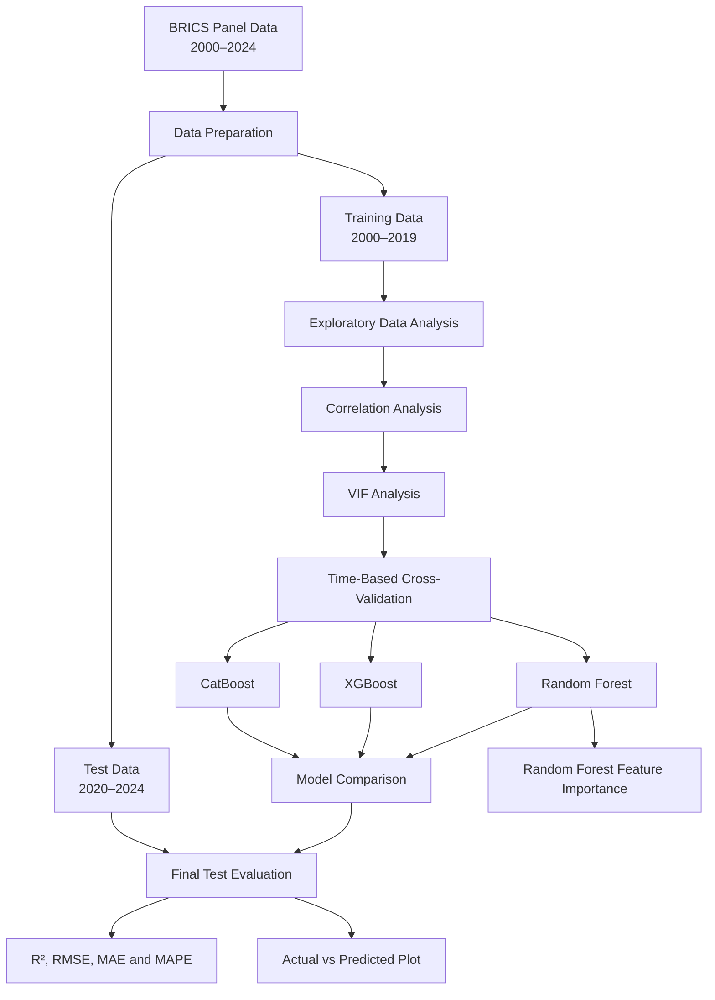
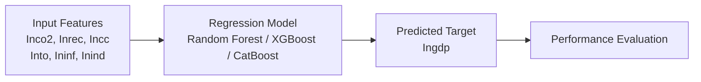

# Machine Learning Analysis of Economic Growth in BRICS Countries (2000–2024)

## 📌 Project Overview

This project investigates the relationship between economic growth and selected environmental, energy, financial, and macroeconomic indicators across five BRICS countries from 2000 to 2024 using machine learning techniques.

The study uses historical panel data to analyze predictive relationships between economic growth and six explanatory variables. Multiple regression models are evaluated using time-based cross-validation and a separate test dataset.

## 🎯 Objectives

- Analyze economic growth patterns across five BRICS countries.
- Examine relationships between economic growth and selected explanatory variables.
- Assess multicollinearity among the predictors.
- Train and compare machine learning regression models.
- Use chronological cross-validation to evaluate model performance.
- Evaluate predictions on unseen observations from 2020–2024.
- Visualize actual versus predicted values.
- Examine Random Forest feature importance.

## 📊 Dataset Description

The dataset covers five BRICS countries over the period 2000–2024.

| Dataset | Period | Purpose |
|---|---|---|
| Training dataset | 2000–2019 | Model training, tuning, and temporal cross-validation |
| Test dataset | 2020–2024 | Final evaluation on unseen observations |

### Variables

| Variable | Description |
|---|---|
| `Ingdp` | Log-transformed GDP; target variable |
| `Inco2` | Log-transformed CO₂ emissions |
| `Inrec` | Log-transformed renewable energy indicator |
| `Incc` | Log-transformed carbon credits indicator |
| `Into` | Log-transformed trade openness indicator |
| `Ininf` | Log-transformed inflation indicator |
| `Inind` | Log-transformed industrialization indicator |
| `COUNTRY NAME` | Country identifier |
| `YEAR` | Year of observation |

*Note: The variable names and transformations follow the supplied dataset. Exact indicator definitions, units, and sources should be documented from the original data sources.*

## 🛠️ Technologies Used

- **Python** — Programming and analysis
- **Pandas** — Data manipulation
- **NumPy** — Numerical computations
- **Matplotlib** — Data visualization
- **Seaborn** — Statistical visualizations
- **Scikit-learn** — Machine learning, pipelines, evaluation metrics, and temporal cross-validation
- **XGBoost** — Gradient-boosted regression
- **CatBoost** — Gradient boosting regression
- **Jupyter Notebook** — Interactive analysis

## 🔬 Methodology

The project follows these stages:

1. **Data preparation:** Load the training and test datasets and select the target and predictor variables.
2. **Exploratory data analysis:** Examine descriptive statistics and variable distributions.
3. **Correlation analysis:** Investigate linear relationships among the analysis variables.
4. **Multicollinearity assessment:** Calculate Variance Inflation Factors (VIF).
5. **Temporal cross-validation:** Create chronological training and validation splits using the training period.
6. **Model training and tuning:** Train and tune Random Forest, XGBoost, and CatBoost regression models.
7. **Model comparison:** Compare models using cross-validation results.
8. **Final evaluation:** Evaluate model predictions on the held-out 2020–2024 dataset.
9. **Visualization:** Plot actual versus predicted values.
10. **Feature importance:** Extract and visualize Random Forest feature importance.

## 🔄 Project Workflow

The following diagram summarizes the main stages of the analysis.



## 🏗️ Model Structure

The project uses supervised regression to estimate `Ingdp` from six explanatory variables.



### Model Inputs and Output

- **Input features:** `Inco2`, `Inrec`, `Incc`, `Into`, `Ininf`, and `Inind`
- **Target variable:** `Ingdp`
- **Task:** Supervised regression
- **Training period:** 2000–2019
- **Testing period:** 2020–2024

The models learn predictive patterns from historical observations. Predictions are compared with actual target values to evaluate performance on unseen observations.

## 🤖 Machine Learning Models

### 1. Random Forest Regressor

Random Forest is an ensemble learning algorithm that combines predictions from multiple decision trees. It can capture nonlinear relationships and interactions among predictors.

The analysis also extracts built-in Random Forest feature importance to examine the relative contribution of predictors to the model.

### 2. XGBoost Regressor

XGBoost uses gradient boosting to build decision trees sequentially, with each stage attempting to improve the overall model.

### 3. CatBoost Regressor

CatBoost is a gradient-boosting algorithm that builds an ensemble of trees and can model complex nonlinear relationships.

Hyperparameter tuning and time-based cross-validation are used to assess model performance.

## 📏 Evaluation Metrics

| Metric | Interpretation |
|---|---|
| R² | Measures how well predictions explain variation in the target |
| RMSE | Measures prediction error while penalizing larger errors |
| MAE | Measures the average absolute prediction error |
| MAPE | Measures average absolute percentage error |

Higher R² generally indicates a better fit, while lower RMSE, MAE, and MAPE indicate smaller prediction errors. Metrics should be interpreted together rather than relying on a single measure.

## 📈 Visualizations

The notebook includes the following analyses and visualizations:

- Descriptive statistics and variable distributions
- Correlation matrix
- Variance Inflation Factor (VIF) results
- Actual versus predicted economic growth
- Random Forest feature importance

## 📁 Repository Structure

```text
brics-economic-growth-ml/
│
├── ML_Model.ipynb    # Analysis and model development
├── README.md         # Project documentation
└── .gitignore        # Excludes datasets and temporary files
```

The notebook contains the data analysis, temporal cross-validation, model training and tuning, evaluation, visualizations, and feature importance analysis.

The raw Excel datasets are excluded from version control. Users must obtain the appropriate data files separately and configure the file paths in the notebook.

## ⚙️ Installation and Setup

### 1. Clone the repository

```bash
git clone https://github.com/aasthasethi28/brics-economic-growth-ml.git
cd brics-economic-growth-ml
```

### 2. Create a virtual environment (optional)

```bash
python -m venv .venv
```

Activate it on Windows:

```powershell
.venv\Scripts\Activate.ps1
```

### 3. Install the required libraries

```bash
pip install pandas numpy matplotlib seaborn scikit-learn xgboost catboost openpyxl jupyter
```

### 4. Prepare the datasets

Place the training and test Excel files in the locations expected by the notebook. Update the file paths in the notebook if necessary.

### 5. Run the notebook

```bash
jupyter notebook
```

Open `ML_Model.ipynb` and execute the cells in order.

## ⚠️ Limitations

- Historical patterns may not represent future economic conditions.
- Cross-validation performance may differ from performance on the held-out test period.
- Feature importance reflects model behavior and does not establish causality.
- Results depend on the quality, definitions, and consistency of the source data.
- Country-level differences and temporal changes may affect model generalization.

## 🚀 Future Improvements

Potential extensions include:

- Documenting data sources, indicator definitions, and units.
- Adding a reproducible dependency file such as `requirements.txt`.
- Evaluating model stability across countries and time periods.
- Exploring additional validation approaches appropriate for panel data.
- Applying further interpretability methods to complement feature importance analysis.

## 👩‍💻 Author

**Aastha Sethi**

B.Tech — Artificial Intelligence and Machine Learning

GitHub: [@aasthasethi28](https://github.com/aasthasethi28)

## 📄 Disclaimer

This project analyzes historical economic and related indicators for academic and research purposes. Predictive relationships should not be interpreted as proof of causal effects.
