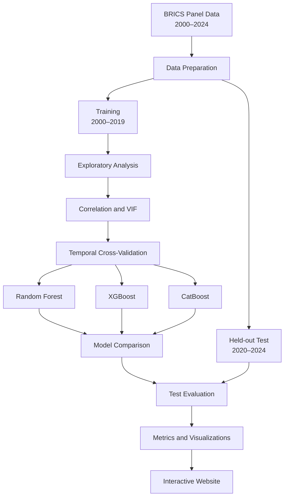
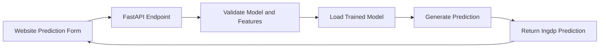

# 🌍 BRICS Economic Growth Lab
### Machine Learning Research · Interactive Analytics · Economic Indicators

<p align="center">
  <a href="https://brics-growth-insights.lovable.app">
    
  </a>
  <a href="https://github.com/aasthasethi28/brics-economic-growth-ml">
    
  </a>
</p>

<p align="center">
  <b>Exploring the relationship between economic growth and environmental, energy, financial, and macroeconomic indicators across five BRICS countries from 2000 to 2024.</b>
</p>

---

## 🚀 Explore the Project

| Resource | Description |
|---|---|
| 🌐 **[Open Live Website](https://brics-growth-insights.lovable.app)** | Explore the research showcase, interactive dashboard, methodology, and prediction interface. |
| 💻 **[View Source Code](https://github.com/aasthasethi28/brics-economic-growth-ml)** | Browse the research notebook and website source code. |
| 📊 **[Open ML Notebook](./ML_Model.ipynb)** | Review the machine learning analysis and experiments. |
| 📖 **[Research Methodology](#-methodology)** | Understand the data preparation, validation, and evaluation process. |

> **Data integrity note:** The website may display illustrative demo data to demonstrate the interface. Such values are not empirical research results. Use verified experimental outputs for scientific interpretation.

## 📌 Project Overview

BRICS Economic Growth Lab is a research and analytics project combining a machine learning notebook with a web-based interface.

The project examines the predictive relationships between economic growth and six explanatory variables representing emissions, renewable energy, carbon credits, trade openness, inflation, and industrialization.

The repository brings together:
- A Python-based machine learning research workflow.
- An interactive web dashboard for exploring results.
- A methodology and variable documentation section.
- A prediction interface designed to connect with trained models through a Python API.

## 📊 Project at a Glance

| Component | Details |
|---|---|
| Geographic scope | Five BRICS countries |
| Study period | 2000–2024 |
| Training period | 2000–2019 |
| Held-out test period | 2020–2024 |
| Target variable | `Ingdp` |
| Predictor variables | Six |
| Regression models | Random Forest, XGBoost, CatBoost |
| Evaluation metrics | R², RMSE, MAE, MAPE |
| Frontend | React and TypeScript |
| Visualization | Interactive charts |
| Prediction backend | Python and FastAPI scaffold |

## 🎯 Research Objectives

1. Examine economic growth patterns across the five countries.
2. Analyze correlations between the target and explanatory variables.
3. Assess multicollinearity using Variance Inflation Factors (VIF).
4. Train and compare tree-based machine learning regression models.
5. Evaluate models using chronological cross-validation.
6. Test generalization on the held-out 2020–2024 observations.
7. Examine Random Forest feature importance.
8. Present the methodology and results through an accessible web interface.

## 🧭 Interactive Project Workflow



## 🌐 Website Features

Open the **[live website](https://brics-growth-insights.lovable.app)** to explore the project presentation.

| Section | Purpose |
|---|---|
| Overview | Introduces the research question, scope, and project objectives. |
| Methodology | Explains the variables, training/test periods, and modeling workflow. |
| Dashboard | Provides a place to explore indicator trends, model comparisons, and analysis outputs. |
| Prediction | Presents a form designed to request predictions from the Python backend. |
| Limitations | Describes interpretation constraints and data limitations. |

### Dashboard data

The dashboard is designed to use verified research outputs. Illustrative preview values, where enabled, are explicitly labeled and should not be cited as findings.

### Live prediction status

The prediction interface requires a running API and compatible trained model artifacts. A working interface alone does not mean that a trained model is connected or that predictions are available.

## 📁 Dataset and Variables

The analysis uses separate training and test datasets.

| Dataset | Years | Role |
|---|---|---|
| Training dataset | 2000–2019 | Model fitting and temporal validation |
| Test dataset | 2020–2024 | Final evaluation on unseen observations |

### Target and predictors

| Variable | Description |
|---|---|
| `Ingdp` | Log-transformed GDP; prediction target |
| `Inco2` | Log-transformed CO₂ emissions indicator |
| `Inrec` | Log-transformed renewable energy indicator |
| `Incc` | Log-transformed carbon credits indicator |
| `Into` | Log-transformed trade openness indicator |
| `Ininf` | Log-transformed inflation indicator |
| `Inind` | Log-transformed industrialization indicator |

The exact definitions, units, transformations, and data sources should be confirmed from the original dataset documentation.

## 🔬 Methodology

1. **Data preparation:** Load and organize the country-year observations.
2. **Descriptive analysis:** Examine the distribution and summary statistics of the variables.
3. **Correlation analysis:** Evaluate pairwise linear relationships.
4. **Multicollinearity analysis:** Calculate VIF values for the predictors.
5. **Temporal validation:** Use chronological splits so validation years follow training years.
6. **Model training and tuning:** Evaluate Random Forest, XGBoost, and CatBoost.
7. **Model evaluation:** Calculate R², RMSE, MAE, and MAPE.
8. **Visualization:** Compare observed and predicted values.
9. **Interpretability:** Examine built-in Random Forest feature importance.
10. **Presentation:** Make verified findings accessible through the website.

### Why temporal validation?

Randomly splitting observations can allow later years to influence model development when predicting earlier or future periods. Chronological validation better reflects the intended task of learning from historical observations.

The 2020–2024 test set should remain separate from model fitting and hyperparameter selection.

## 🤖 Machine Learning Models

### Random Forest Regressor
An ensemble of decision trees that can model nonlinear relationships between the selected predictors and the target.

### XGBoost Regressor
A gradient-boosting algorithm that builds trees sequentially to improve predictive performance.

### CatBoost Regressor
A gradient-boosting method that learns an ensemble of decision trees.

### Evaluation metrics

| Metric | Meaning | Preferred direction |
|---|---|---|
| R² | Variation in the target explained by model predictions | Generally higher |
| RMSE | Error measure that penalizes larger errors | Lower |
| MAE | Average absolute prediction error | Lower |
| MAPE | Average absolute percentage error | Lower |

Actual performance numbers should be added only from verified experiment outputs. A model's cross-validation ranking may differ from its performance on the held-out test period.

## 🏗️ Prediction API Architecture

The website is designed to communicate with a Python FastAPI backend.



Expected endpoints:

| Endpoint | Purpose |
|---|---|
| `GET /api/health` | Check backend and model availability |
| `POST /api/predict` | Request a prediction from a selected trained model |

The prediction endpoint expects six numeric inputs: `Inco2`, `Inrec`, `Incc`, `Into`, `Ininf`, and `Inind`.

**Important:** The backend must load compatible models trained on the same feature definitions and ordering. If preprocessing was used during training, it must be included with the exported model. No genuine prediction should be claimed until this integration has been tested successfully.

## 🛠️ Technology Stack

- Python
- Pandas and NumPy
- Scikit-learn
- XGBoost
- CatBoost
- Jupyter Notebook
- React
- TypeScript
- Charting library used by the frontend
- FastAPI for the prediction API

## 📂 Repository Structure

```text
brics-economic-growth-ml/
│
├── ML_Model.ipynb
├── README.md
├── .gitignore
│
└── website/
    ├── package.json
    ├── public/
    ├── src/
    └── backend/
        ├── main.py
        └── requirements.txt
```

*The website folder structure above is illustrative; filenames may differ in the actual repository. Keep the README consistent with the files committed to GitHub.*

## ⚙️ Running the Project Locally

### 1. Clone the repository

```bash
git clone https://github.com/aasthasethi28/brics-economic-growth-ml.git
cd brics-economic-growth-ml
```

### 2. Run the research notebook

Install the Python libraries required by the notebook, then launch Jupyter:

```bash
pip install pandas numpy matplotlib seaborn scikit-learn xgboost catboost openpyxl jupyter
jupyter notebook
```

Open `ML_Model.ipynb`. Ensure the required datasets are available locally and the notebook paths are configured correctly.

### 3. Run the website

```bash
cd website
npm install
npm run dev
```

Use the local URL displayed by the development server.

If the project uses Bun rather than npm, follow the scripts and package manager specified in its `package.json`.

### 4. Run the prediction backend

If the backend files are present:

```bash
cd backend
pip install -r requirements.txt
```

Configure the environment variables and trained-model paths according to `backend/README.md` or the backend configuration. Start the service using the documented FastAPI command.

The backend will only return real predictions when compatible trained model files are configured.

## 🔐 Data and Security

- Raw datasets should not be committed unless sharing is authorized.
- Keep `.env` files, API keys, and other credentials out of Git.
- Exclude local virtual environments, caches, and generated model artifacts as appropriate.
- Provide data-source documentation and respect applicable dataset licenses.
- Never label illustrative values as empirical findings.

## ⚠️ Limitations

- Historical patterns may not generalize to future economic conditions.
- Performance can differ between temporal validation and the final test period.
- Feature importance describes model behavior, not causal effects.
- Results depend on source-data quality, definitions, and consistency.
- Live predictions require correctly configured trained models and preprocessing.
- Country-level and time-specific differences may affect generalization.

## 🚀 Future Improvements

- Connect verified model results to the dashboard.
- Integrate and test the trained-model prediction API.
- Document data sources and indicator definitions.
- Improve reproducibility with dependency files and consistent paths.
- Evaluate model stability across countries and periods.
- Extend model interpretation and robustness analysis.

## 👩‍💻 Author

**Aastha Sethi**  
B.Tech — Artificial Intelligence and Machine Learning

GitHub: [@aasthasethi28](https://github.com/aasthasethi28)

## 📄 Disclaimer

This project is intended for academic and research purposes. Machine learning predictions and feature importance should not be interpreted as evidence of causal effects.

---

<p align="center">
  <b>Explore the research. Interact with the dashboard. Understand the models.</b><br/>
  <a href="https://brics-growth-insights.lovable.app">Launch BRICS Economic Growth Lab →</a>
</p>

